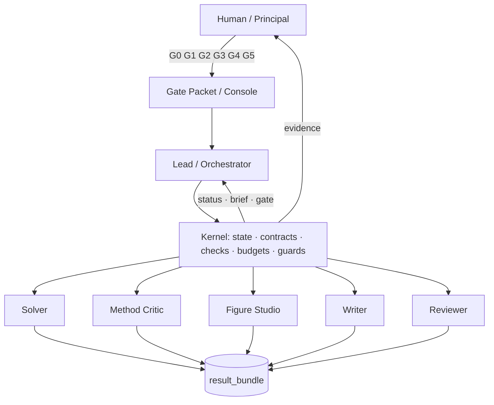
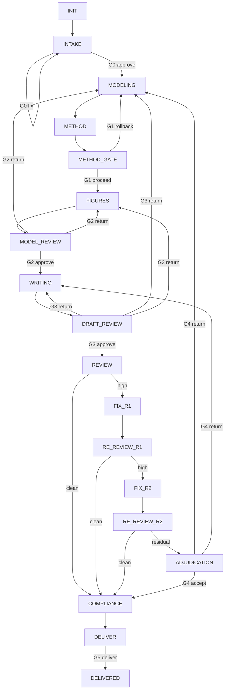

# 数模 B 题人机协同智能体团队 · 运行框架 v3

> 状态：Phase 0 设计定稿（`framework_version=3.0.0`，`schema_version=2026-10-19`）
> 适用范围：CUMCM B 题（`opt` / `stats`）与 `shuwei_en` 赛制；仅比赛模式。
> 本文是**目标框架**；现行 Trae 流水线（根目录 `AGENTS.md` + `.trae/`）在新系统通过校准前仍是回退基准。
> 机器可读规格：`framework.json`；机查清单：`checks.json`；迁移矩阵：`migration-map.md`；场景测试：`tabletop-tests.md`。

---

## 0. 一句话结论

现有框架图把**"谁在什么时候做什么、人什么时候介入"**画对了。它缺的不是角色，而是角色之间的**产物契约、机器可验的证据、持久状态、时间/成本预算，以及独立评审的上下文隔离**。

新框架不推翻主链路，而是把它从**"对话流"**升级为**"契约 + 状态机"**：

- **控制面**：确定性内核（状态、契约、机查、预算、守卫）+ Lead；
- **生产面**：Solver / Method / Figures / Writer / Reviewer，上下文隔离；
- **决策面**：人只在**高杠杆决策**和**例外**上出现；
- **事实层**：artifact registry、run_state、events、check reports，唯一事实源。

目标：**质量不降、成本下降**。质量靠契约、机查、独立批评和人只看高杠杆决策；成本靠确定性内核、effort 路由、少而准的人工门、可度量预算。

---

## 1. 对现有框架图的判断

### 1.1 做对的五件事

1. **主链路正确**：Lead 编排 → 建模 → 方法学批评 → 出图 → 写作 → 独立评审。这是数模流水线的最小完备集。
2. **人机边界选得对**：赛制确认、方法回退、成图质量、评审通过，都是人类判断价值最高的点。
3. **回退箭头不是装饰**：方法不接受、图不接受、评审不通过都有回路，说明作者理解"一次成型"不现实。
4. **方法学批评放在出图前**，且要求"列方案 + 推荐 + 理由"——这是质量杠杆最大的位置，很多团队缺这一环。
5. **生产、批评、评审分离**：符合三权分立，避免建模者自己给自己打分。

### 1.2 十个结构性缺口（按影响排序）

| # | 缺口 | 后果 |
|---|---|---|
| 1 | 框与框之间没有产物契约 | 下游重解释上游"策略"，信息失真；质量靠 agent 记忆 |
| 2 | 没有题型轨 | `opt`/`stats` 的方法、验证、评审混在一起；错轨代价最大 |
| 3 | 人工点过密且无决策包 | 5 次上下文切换；后半夜走过场；"进入绘图"与图审重复 |
| 4 | 没有确定性机查 | 页数、摘要、匿名、数值一致性靠模型记得；不可复现 |
| 5 | 没有状态与恢复 | 会话中断/agent 崩溃后无法接管；容易重复或跳步 |
| 6 | 没有时间/成本预算 | 某阶段无限打磨；72h 硬约束失效；成本无法度量 |
| 7 | 独立评审无上下文隔离 | reviewer 被 solver/writer/method 锚定，盲审失效 |
| 8 | 缺少交付合规 | 页数、匿名、附录代码、打包/MD5 是取消评奖级风险 |
| 9 | 回退路由靠 Lead 临场判断 | Lead 成瓶颈；图面问题退回 solver，浪费一轮 |
| 10 | 没有质量/成本度量 | 无法证明新系统更好或更便宜；优化无方向 |

### 1.3 结论

- **保留**：主链路、三权分立、方法学批评、独立评审、回退回路、人机高风险判断。
- **新增**：确定性内核、产物契约、机查证据链、持久状态、预算、上下文隔离、合规阶段。
- **做减法**：5 个人工点 → **3 个必过（G0/G2/G3）+ 2 个例外（G1/G4）+ 1 个交付确认（G5）**；典型路径 4 次人工交互。

---

## 2. 目标与成功标准

### 2.1 质量（硬约束，不为成本让步）

- 合规检查 ERROR = 0。
- 最优性验证 / 模型验证 / 灵敏度分析 **100% 在场**（适用时）。
- reviewer 找出的 high severity：全部修复，或有记录的接受理由。
- 机查证据链审计 ERROR = 0（禁止"登记了但没跑"）。
- 人工退回 ≤ 1 次/门；人工 override 全部留痕。
- 用同一道往年题做 A/B，review 分数不低于基线。
- 关键角色使用档位配置的当前主力模型与 effort；模型不可用则暂停，不静默降级。

### 2.2 成本（设计目标，Phase 4 用真实数据验证）

- token 成本下降 **≥ 20%**；人工决策时间下降 **≥ 30%**；wall time 不增加；验证项一项不删。
- 当前 `deepseek-flash`（DeepSeek-V4.1-Flash）单价低，**成本主要来自 token 量、调用次数和返工轮次，而不是模型单价**。路由杠杆是 effort、调用次数、上下文长度和人工门数量。
- **局部 resume 省去重读/重跑 METHOD；根因 fresh 的成本用计划门 + 回归测试换质量，不能为省 token 强行 resume 根因。**
- 未达标则框架不算完成；先诊断成本报告，再调设计，不改口径。

### 2.3 度量方式

| 指标 | 来源 | 用途 |
|---|---|---|
| token/角色/阶段 | DSH `tokenMeter` + session 映射 | 找成本热点；对比基线 |
| wall minutes/阶段 | `run_state.stage_timestamps` | 找进度瓶颈 |
| human minutes/门 | gate 决策时间戳 | 验证"人工点做减法" |
| review 五维分数 | `review_report.json` | 质量信号，不设下限 |
| high severity / 修复成功率 | `review_report.json` + fix 日志 | 质量与修复回路健康度 |
| 合规 ERROR / 机查审计 ERROR | check reports | 硬门 |
| 人工退回数 / override 数 | `gate_decisions.jsonl` | 门与决策包质量 |

基线：先跑一次校准题；没有旧系统数据就以首次新运行为基线，后续迭代对比。

---

## 3. 目标架构

### 3.1 三面一层

| 层 | 组成 | 职责 | 成本 |
|---|---|---|---|
| **控制面** | Kernel（Host plugin）+ Lead | 状态机、产物契约、机查、预算、守卫、决策包 | 机查 0 token；Lead 只读摘要 |
| **生产面** | Solver / Method / Figures / Writer / Reviewer | 专业产出，上下文隔离 | 模型 token |
| **决策面** | Human + Gate Packet / Gate Console | 高风险判断、例外裁决、交付确认 | 人工时间 |
| **事实层** | Artifact Registry + run_state + events + check reports | 唯一事实源，可审计、可恢复 | 0 token |

**原则：Lead 按状态编排，不按内容编排。** Lead 读 `pipeline_status` 的摘要（≤1KB），不读 20KB 的 `solution.json`；需要细节时按路径读。

### 3.2 架构图



### 3.3 单一事实源

| 事实 | 载体 | 写者 | 读者 |
|---|---|---|---|
| 框架规格 | `system/framework.json` | 人（版本化） | Kernel/Lead/开发 |
| 运行状态 | `<run_root>/run_state.json` | Kernel | Lead/Human |
| 审计事件 | `<run_root>/events.jsonl` | Kernel | Lead/Human |
| 门决策 | `<run_root>/gate_decisions.jsonl` | Kernel | Lead/Human |
| 产物注册 | `framework.json.artifacts` | 人（版本化） | Kernel/Lead |
| 检查证据 | check reports + `checks` state | Kernel | Lead/Reviewer/Human |
| 兼容视图 | `pipeline_state.json` | Kernel | 现有 Python 机查 |

**禁止以"文件是否存在"反推状态**；状态以 `run_state.json` 为准。`pipeline_state.json` 是 Kernel 生成的兼容视图，不是第二事实源。

---

## 4. 运行状态机

### 4.1 状态表

| 状态 | 责任方 | 主要产出 | 退出条件 | 失败去向 |
|---|---|---|---|---|
| `INIT` | Lead + Kernel | run 目录、run_state、events | 环境预检启动 | STOPPED |
| `INTAKE` | Lead + 脚本 | 题面转写、附件清单、track 建议、环境预检 | G0 批准 | BLOCKED |
| `MODELING` | Solver | result_bundle、project、handoff_notes_1 | 建模门机查全过 / 返工完成 | 重试/BLOCKED |
| `METHOD` | Method Critic | method_critique.md/json | verdict/recommend 合法 | BLOCKED |
| `METHOD_GATE` | Kernel + Human | G1 决策 | 放行/按票回退/停止 | 回退 → MODELING |
| `FIGURES` | Figure Studio | figures/、图表清单 | 视觉机查全过 | 重试/BLOCKED |
| `MODEL_REVIEW` | Kernel + Human | G2 决策 | 批准/退回 | 退回 MODELING/FIGURES |
| `WRITING` | Writer | paper.tex/pdf、摘要候选、handoff_notes_2 | 写作门机查全过 | BLOCKED |
| `DRAFT_REVIEW` | Kernel + Human | G3 决策 | 批准/退回 | 退回 WRITING/MODELING/FIGURES |
| `REVIEW` | Reviewer | review_report、review_scores、handoff_notes_3 | 评审产物齐全 | 重试/BLOCKED |
| `FIX_R1` / `RE_REVIEW_R1` | Writer / Reviewer | fix_round1、更新报告 | 无 high severity | 进入 R2 |
| `FIX_R2` / `RE_REVIEW_R2` | Writer / Reviewer | fix_round2、更新报告 | 无 high severity | G4 |
| `ADJUDICATION` | Kernel + Human | G4 决策 | 接受/退回/停止 | 退回对应阶段 |
| `COMPLIANCE` | Kernel + Lead | 打包、MD5、合规报告 | 合规门全过 | BLOCKED |
| `DELIVER` | Human | G5 确认 | 交付/停止 | STOPPED |
| `DELIVERED` | Kernel | run_report、cost_report | 终态 | — |
| `BLOCKED` | Kernel + Lead | 阻塞记录 | 人的决定 | 恢复/停止 |
| `STOPPED` | Kernel | run_report | 终态 | — |

> `PAUSED` 不是独立状态，而是 `run_state.status` 上的一个标志（`PAUSED=true`），用于睡眠/等待；恢复时回到原阶段，不重复已过门。

### 4.2 状态图



> repair 边：`COMPLIANCE → WRITING`（T46，合规修复）、`WRITING → COMPLIANCE`（T52，合规修复完成）、`WRITING → MODEL_REVIEW`（T53，G2 批准物 hash 失效）、`REVIEW → DRAFT_REVIEW`（T54，论文在修复回路外改动）、`MODELING → $return_target`（T55，返工完成回到最早 stale 的下游）。完整转移见 `framework.json`。

### 4.3 循环与上限

| 循环 | 上限 | 超出后 |
|---|---|---|
| G0 fix → INTAKE | 2 次 | 停止或换项目根 |
| METHOD → MODELING（按票回退） | 1 次/轮批评；建模返工总计 ≤3 | G1/G4 人裁决 |
| G2 图面退回 → FIGURES | 2 次 | 人接受或停止 |
| G3 退回 → WRITING | 2 次 | 人接受或停止 |
| REVIEW → FIX R1/R2 | 2 轮 | G4 |
| 任意阶段崩溃重试 | 2 次 | BLOCKED |

**stale 传播**：

- `MODELING` 变更 → `METHOD` / `FIGURES` / `WRITING` / `REVIEW` 作废；
- `FIGURES` 变更 → `WRITING` / `REVIEW` 作废；
- `WRITING` 变更 → `REVIEW` 作废。

Kernel 自动标记；禁止因旧文件存在而跳过重做。

### 4.4 典型路径

- **干净 opt**：G0 → Solver → METHOD PASS（自动放行）→ FIGURES → G2 → Writer → G3 → Reviewer PASS（跳过 R1/R2）→ COMPLIANCE → G5。人工 4 次（G0/G2/G3/G5）。
- **方法 BLOCKED**：Solver → METHOD BLOCKED → G1 → Kernel 写 brief → 新 Solver → METHOD 重跑 → FIGURES → G2。
- **图面退回**：G2 退回图 → 新 Figures → G2；写作未开始，不产生写作 stale。
- **评审 R1/R2**：Reviewer high → Writer 修复 → Reviewer 全文复读 → 仍 high → R2 → 仍 high → G4。
- **合规超页**：COMPLIANCE ERROR → Writer 压缩 → 重编译 → 重跑 COMPLIANCE。

---

## 5. 角色与上下文

### 5.1 角色表

| 角色 | DSH 形态 | 上下文 | 模型/effort（balanced） | 技能 | 可写 | 禁写 | 主要产出 |
|---|---|---|---|---|---|---|---|
| **Lead** | 常驻 Lead | 持久 | flash/high | `pipeline-protocol` | 仅经 Kernel 写状态、gate packet、brief | 专业产物 | 编排、决策包、路由 |
| **Solver** | 一次性 specialist（可续接） | 初始 fresh；局部返工 resume；根因返工 fresh+dossier | flash/max | `solver-opt` / `solver-stats` | `project/**`、`result_bundle/**`、`handoff_notes_1`、`rework_plan.json` | paper、figures、method_critique、pipeline_state | solution/plan/fingerprint/术语表 |
| **Method** | 一次性 specialist | 干净，不继承 solver | flash/max | `method-critic` + 本轨 gate | method_critique.* | project/**、solution、paper | verdict/tickets/recommend |
| **Figures** | 一次性 specialist | 干净 | flash/high | `figure-studio` | figures/**、图表清单 | solution 数值、paper | 双格式图 + 清单 |
| **Writer** | 常驻 teammate | 初稿 fresh；R1/R2 续接 | flash/high（继承 Lead） | `paper-writer` | paper.tex/pdf、abstract_candidates、handoff_notes_2、fix_round* | project/**、figures、solution、method_critique | 论文 + 摘要候选 |
| **Reviewer** | 一次性 specialist（可续接） | 初始 fresh；R1 局部 resume / 根因 fresh；R2 默认 resume，失败率高 fresh；不读 method_critique | flash/max | `independent-reviewer` + 检查单 | review_report、review_scores、handoff_notes_3 | paper.tex、figures、solution | 五维评分 + 12 项 + 红队 |
| **Gate Packet** | 一次性 specialist（可选） | 干净 | flash/off | — | 无 | 专业产物 | 决策包草稿 |
| **Kernel** | Host plugin | — | 无模型 | — | run_state、gate_decisions、reports、cost | 专业产物 | 状态/契约/机查/预算/守卫 |
| **Human** | 用户 | — | — | 门卡 | 决策 | — | 目标、例外裁决、交付确认 |

### 5.2 拓扑决策

**"团队"的本质是角色分工 + 契约 + 独立上下文，不是必须全部常驻一个 roster。**

- **Lead + Writer 用 Team 持久成员**：Writer 需要 R1/R2 续接，避免每次重读论文；人也能在 roster 里看到写作会话。
- **Method / Figures 永远一次性 fresh**；**Solver / Reviewer 默认一次性，但有生命周期策略**：
  - Solver 初始 fresh；局部返工 **resume 同一 child**；根因返工 **fresh + 失败档案 + 计划门 + 回归测试**；
  - Reviewer 初始 fresh；R1 局部 **resume**、根因 **fresh**；R2 默认 **resume**，失败率高/模型变动 **fresh**；
  - 这样既避免每次都重读上下文，也避免被旧方法锚定；**fresh 的"记忆"由失败档案负责，不由旧对话负责**。
  - specialist 可以逐次指定 model/effort，而 `spawn_teammate` 没有模型参数，持久成员会继承 Lead 的 model/effort。**当前所有角色同一模型（V4.1-Flash），选 specialist 的关键原因是 fresh 上下文、逐次 effort 控制和避免 roster 固定成本，而不是模型 tier。**
- 如果 Team profile 把基础 `subagent` 工具禁用了，Phase 2 的框架 bundle 需要**另起一个不同 toolName 的 `dsh-tool-subagent` 实例**（如 `specialist`），或退回 `workflow.agent()`；Phase 2 用 `cordis_inspect_query` 验证后再定。
- 如果用户希望 roster 更"满"，可以把 Solver/Reviewer 提升为持久成员，代价是统一 model/effort 和固定 Team 工具 schema 成本；默认不做。

#### 5.2.1 返工生命周期决策表

| 触发 | Solver | Reviewer | 必须继承的东西 |
|---|---|---|---|
| 数值/代码 bug、单个子问、单条约束、单个灵敏度参数 | **resume** 同一 child | R1 **resume** | fix brief + diff；只跑受影响检查 |
| 方法 BLOCKED、票会改结论形态、模型/算法/轨/数据划分/目标/约束变化、影响 ≥2 子问、上下文丢失 | **fresh_dossier** | 返工后 **fresh** | 失败档案 + 重做计划门 + 回归测试 + 旧产物 attic |
| R1 修复失败率 ≥30%、引入跨节新错、数值/模型改动 | — | R2 **fresh** | 上轮报告 + fix log + diff 作核对清单；仍全文通读 |
| 人要求第二意见 | fresh 或 fresh method | **fresh_independent** | 论文 + fix log；独立评分，不抄上轮分数 |
| 无法判定 | **fresh_dossier**（保守） | 按缺陷类型 | 失败档案 + 计划门 |

**判定权**：Kernel 按 trigger 建议；Lead 可带理由改判；人可在 G1/G2/G4 覆盖；全部写 `run_state.freshness_decisions[]`。

> **Phase 2A 落地**：7 个 project-local skills 在 `.dsh/skills/`（`pipeline-protocol`、`solver-opt`、`solver-stats`、`method-critic`、`figure-studio`、`paper-writer`、`independent-reviewer`）；编制、派活模板与降级路径见 [`system/team/team-blueprint.md`](team/team-blueprint.md)。本阶段不新建 plugin/preset。

### 5.3 模型选择与 effort 路由

**当前主力：`deepseek-flash`（DeepSeek-V4.1-Flash）——既是当前最强，也是当前最便宜。** 不按版本号/名称判断强弱；模型选择以实测校准为准。catalog 中的 `deepseek-v4-pro`（V4-Pro）当前不作为主链路；等 V4.1-Pro 出来后先做 A/B，再决定是否切换。

| 运行档位 | Lead | Writer（继承） | Solver | Method | Figures | Reviewer | Gate packet | 用途 |
|---|---|---|---|---|---|---|---|---|
| **quality** | flash/max | max | flash/max | flash/max | flash/high | flash/max | flash/off | 正式比赛 |
| **balanced（默认）** | flash/high | high | flash/max | flash/max | flash/high | flash/max | flash/off | 练习/常规 |
| **economy** | flash/high | high | flash/high | flash/high | flash/high | flash/high | flash/off | 草稿；不可用于最终 |

- **所有角色同一模型**；档位差异只在 **reasoning effort、调用次数、验证深度、人工门数量**，不是模型单价。
- 持久成员继承 Lead 的 model/effort；因此 Writer 的 effort 由档位设置 Lead effort 解决（quality 档 Lead=max，Writer=max；balanced 档 Lead=high，Writer=high）。
- 一次性 specialist 逐次指定 model/effort：solver/method/reviewer 用 max，figures 用 high，gate packet 用 off/low。
- **未来升级策略**：V4.1-Pro（或任何更强模型）出现时，只改 `framework.json` 的 `model_routing`，不改技能/机查/提示词；先跑同一道校准题，质量不降且成本可接受才切换；切换记录 `route_version` 与 A/B 结果。
- **模型名只出现在 `framework.json`**；`pipeline_brief` 把实际 route 注入角色 brief；skills/checks 不写死模型名。
- **可用性预检**：INTAKE 校验档位所需 model/effort 是否可用；不可用则暂停，不静默降级。
- **原则**：模型强弱以校准题实测为准；新模型不因名字/版本号直接上主链路；"又强又便宜"是当前 V4.1-Flash 的事实，也是未来选型的门槛。

### 5.4 上下文隔离与写权限

| 角色 | 不得看到 | 不得写 |
|---|---|---|
| Method | solver/writer 对话、论文、图 | project/**、solution、paper |
| Reviewer | solver/writer 对话、method_critique | paper.tex、figures、solution |
| Figures | 论文、method_critique | solution 数值、paper |
| Writer | solver 的建模过程（可读代码用于附录） | project/**、figures、solution |
| Solver | 论文（尚不存在）、method_critique | paper、figures、method_critique |
| Lead | 不读全文，只读摘要 | 任何专业产物 |

- Kernel 守卫：`write`/`edit` 对 `knowledge/`、`system/`、`.trae/`、`pipeline_state.json` 在运行期直接拒绝；对 `result_bundle`/`paper.tex` 按角色舞台做 advisory 拒绝；`bash` 无法完全拦截，靠 gate 时 artifact hash + 人工 diff 兜底（**不宣称沙箱**）。
- Lead 不得代写任何专业产出；Kernel 的 `pipeline_submit` 校验 `produced_by` 角色。

### 5.5 降级模式

Kernel 不可用/插件故障时，Lead 退回当前 `AGENTS.md` 的手工协议（机查脚本照跑、状态写在 `pipeline_state.json`）。**Kernel 是加速器和守卫，不是单点依赖。**

---

## 6. 产物契约

### 6.1 保留现有路径

| 产物 | 路径 |
|---|---|
| 题面 | `赛题/题面.md`、`赛题/附件/`、`赛题/题面图/` |
| 求解包 | `result_bundle/solution.json`、`modeling_plan.json`、`feature_fingerprint.json`、`术语表.json` |
| 代码/数据 | `project/**`、`project/results/*.json` |
| 方法批评 | `decision_logs/method_critique.{md,json}` |
| 图 | `result_bundle/figures/*.{pdf,png}`、`result_bundle/图表清单.md` |
| 论文 | `paper.tex`、`paper.pdf`、`decision_logs/abstract_candidates.md` |
| 评审 | `decision_logs/review_report.json`、`review_scores.md` |
| 交接 | `handoff_notes_1.md`、`handoff_notes_2.md`、`handoff_notes_3.md` |
| 修复 | `decision_logs/fix_round{N}.md`、`fix_points_round{N}.md` |
| 状态 | `run_state.json`、`events.jsonl`、`gate_decisions.jsonl`、`pipeline_state.json` |
| 成本/复盘 | `cost_report.json`、`run_report.json` |

**不换路径、不换文件名**，避免破坏已有 30 多个机查脚本和知识资产。完整注册表见 `framework.json` 的 `artifacts` 段（47 项）。

### 6.2 三层校验

1. **结构**：JSON Schema（`schemas/` 下 7 个）。
2. **语义**：现有 Python 机查脚本（不改判据）。
3. **齐备性 / 交叉**：`check_pipeline_manifest.py` + Kernel 的 artifact hash + stale 检查。

### 6.3 契约表（关键）

| 产物 | 生产者 | 消费者 | 阶段 | 校验 |
|---|---|---|---|---|
| `solution.json` | Solver | Method/Writer/Reviewer | MODELING | 结构 + `check_solution_json(_stats).py` 语义 |
| `modeling_plan.json` | Solver | Method/Writer/Reviewer | MODELING | 同上 + `check_modeling_artifacts` |
| `feature_fingerprint.json` / `术语表.json` | Solver | Method/Writer/Reviewer | MODELING | 模板字段 + 机查 |
| `method_critique.json` | Method | Kernel/Writer | METHOD | verdict/gate/tickets/recommend |
| `figures/` + `图表清单.md` | Figures | Writer/Reviewer/Human | FIGURES | 双格式配对、visual_qa、类型/数量 |
| `paper.tex` / `paper.pdf` | Writer | Reviewer | WRITING | LaTeX/合规/摘要/数值一致性 |
| `review_report.json` / `review_scores.md` | Reviewer | Writer/Kernel | REVIEW | 五维 ≥3 句、12 项、红队证据 |
| `run_state.json` / `gate_decisions.jsonl` / `cost_report.json` | Kernel | Lead/Human | 全程 | 新 schema |
| `failure_dossier.json` / `rework_plan.json` / `regression_check_report.json` | Kernel / Solver / Kernel | Solver/Method/Reviewer | MULTI | 失败档案 schema + 计划门 + 回归测试 |

### 6.4 返工生命周期与 stale

- 返工单由 **Kernel 生成**，不是 Lead 手写：`trigger`、`source_gate`、`ticket_index`、`keep`、`change`、`forbidden`、`must_read`、`return_scope`。
- 人工退回时，Kernel 按缺陷路由表确定退回目标并写 brief；Lead 只负责转述与确认。
- 任何被批准过的 artifact 若 hash 变化，对应 gate 自动失效；Kernel 标记 stale 并要求重审/豁免。
- **返工模式由 Kernel 按 `freshness_policy` 判定**：局部 → `resume`；根因 → `fresh_dossier`；fresh 必须带失败档案、重做计划门、回归测试；旧代码放 `attic`，只作负证据，不作起点。
- **返工不是一律回 METHOD**：Kernel 记录 `rework.return_to` = 最早 stale 的下游（METHOD / FIGURES / WRITING / MODEL_REVIEW / DRAFT_REVIEW / REVIEW / COMPLIANCE）；T55 按此返回。方法未变时，不必重跑整轮 METHOD。
- **重复失败**：同一 `failure_mode` 再次出现 → `repeat_failure=true`，升级 G1/G4，不允许第三次 fresh 未经人批准。

---

## 7. 机查体系

### 7.1 阶段机查清单

> 完整命令、参数、报告路径、超时与条件见 `checks.json`（35 条检查 + 4 条资产维护 + 4 条退役）。

| 阶段 | 顺序 | 阻塞级别 |
|---|---|---|
| INTAKE | `convert_problem` → `check_problem_track` → `check_workspace_hygiene` → `check_pipeline_manifest --stage intake` → `check_machine_checks` | ERROR |
| MODELING |（fresh_dossier）`modeling_rework_plan` → 本轨 `check_solution_json*` → `check_modeling_artifacts --scope modeling` → `check_code_hygiene` → `check_workspace_hygiene` →（stats）`check_leakage` → manifest → machine_checks | ERROR；leakage WARN |
| METHOD | workspace hygiene → manifest → machine_checks | ERROR |
| FIGURES | `check_modeling_artifacts --scope figures` → workspace hygiene → manifest → machine_checks | ERROR |
| WRITING 预检 | `check_latex_env` | ERROR → external compile |
| WRITING | `check_latex_compliance` → `check_tex_numbers`（WARN）→ `check_abstract_guard audit`（WARN）→ workspace hygiene → manifest → machine_checks | ERROR |
| REVIEW | workspace hygiene → manifest → machine_checks | ERROR |
| COMPLIANCE | workspace hygiene → `package_support_materials` → manifest → machine_checks | ERROR |

> **编译降级专项**：`check_latex_env` 报 ERROR 时，Kernel 将 `compile_mode` 置为 `external`，**不阻塞**；`check_latex_compliance` 设为 `defer_on=external_compile`，在用户回传 `.aux`/`.log`/`.pdf` 前保持 **deferred（不是 skipped）**。WRITING 不得在缺 PDF 的情况下过门；COMPLIANCE 前仍未回传 → ERROR，不得交付。

### 7.2 执行顺序与裁定

- **执行顺序铁律**：业务机查 → manifest → machine_checks；Kernel 固定顺序，模型不能改。
- **WARN 裁定权**：仍归下游 agent/人；Kernel 只保证执行、报告、ERROR 清零。
- **Kernel 模式**：Kernel 直接执行并记录 evidence，`check_machine_checks.py` 的"自证"问题消失；fallback 模式仍用它。
- **报告归一化**：Kernel 适配 `errors/warns`、`findings`、`summary.ERROR` 三种形状，统一输出 `{checker, stage, status, error_count, warn_count, findings, report_path, hash, duration}`。

### 7.3 机查资产处置

| 类别 | 处置 |
|---|---|
| 保留（活流水线） | convert_problem、pipeline_manifest、solution_json×2、modeling_artifacts、code_hygiene、workspace_hygiene、leakage、latex_env、latex_compliance、tex_numbers、abstract_guard、machine_checks、package_support_materials、problem_track |
| 资产维护类 | prompt_budget、convention_refs、viz_tests、card_refs（只在资产变更时跑） |
| 退役 | `check_reflection.py`（S1-S4 已非活流水线）、`check_isolation.py`（校准专用，移入进化工具箱）、`check_bc_merge_smoke.py`（一次性）；`test_*` 归 tests/ |

### 7.4 机查作者规则

- 新增/修改机查时，必须同步核对对应 skill/prompt 是否已下达该要求；机查要求集不得超出 prompt 要求集。
- 每条机查必须有报告路径、ERROR/WARN 级别、超时、运行顺序。
- 不得把"模型应该做"的主观判断伪装成机查；机查只做确定性检查。

---

## 8. 人机决策门

### 8.1 门表

| 门 | 时机 | 强制性 | 决策包 | 选项 | 退回路由 | 时限 |
|---|---|---|---|---|---|---|
| **G0** | INTAKE | 必过 | 项目根、赛制、track、题面齐备性、运行档位、时间预算、数据清单、模型/effort 可用性 | 批准 / 修正 / 停止 | 修正 → INTAKE | 15m |
| **G1** | METHOD 后 | **例外** | verdict、闸门一句、票表、推荐 | 放行 / 按票回退 / 停止 | 回退 → MODELING | 10m |
| **G2** | FIGURES 后 | 必过 | 建模摘要 + 方法结论 + 6 图缩略 + 机查摘要 + top3 风险 + 时间/成本 + 建议 | 批准 / 退回建模 / 退回图 / 停止 | 数值/模型/方法 → Solver；图面 → Figures | 30m |
| **G3** | WRITING 后 | 必过 | PDF + 摘要候选 + 合规摘要 + 页数 + top5 风险 + 建议 | 批准 / 退回写作 / 退回建模 / 退回图 / 停止 | 写作 → Writer；建模 → Solver；图 → Figures | 30m |
| **G4** | R2 后残留 high / 合规豁免 / 人要求 | **例外** | 残留问题表 + 修复历史 + 证据 + 建议 | 接受风险 / 退回 / 停止 | 按缺陷类型 | 20m |
| **G5** | COMPLIANCE 后 | 交付确认 | 文件清单 + MD5 + 合规勾选 | 交付 / 停止 | 修正 → COMPLIANCE | 10m |

### 8.2 自动规则

- **G1 自动放行**：`verdict=PASS` 且无票；或 `PASS_WITH_NOTES` 且全部票 `limitations_only`、`recommend.choice=proceed`。记录 `decided_by=auto`，G2 决策包回显。
- **G4 自动跳过**：reviewer `verdict=PASS` 且无 high severity、合规无豁免 → 直接 COMPLIANCE。
- **G2/G3 不自动放行**：这是最高杠杆的人类判断，保留。
- **超时行为**：提醒后仍无响应 → 暂停，不自动批准；G1 的自动放行是规则，不是超时兜底。

### 8.3 决策包（一页）

`pipeline_status view=gate` 生成，字段固定：

```
# Gx 决策包 · <run-id>
## 状态
- 阶段 / 用时 / 成本 / 建议
## 关键结果（≤10 行）
## 方法结论 / 图 / 机查摘要
## 风险（≤3）
## 请决策
- 选项 + 退回原因类别
```

人不需要读聊天记录；需要细节时点路径。

### 8.4 退回路由表

| 缺陷类型 | 退回目标 | 例子 |
|---|---|---|
| 数值 / 模型 / 求解 | Solver | 目标值错、不可行、缺验证、模型结构错 |
| 方法 / 结构 | Solver（G1） | 方法错配、算法类选错 |
| 图面 / 可视化 | Figures | 轴缺单位、图型错、遮挡、缺图 |
| 表达 / 一致性 / 遗漏 | Writer | 符号不一致、段落缺失、引用错 |
| 合规 / 格式 | Writer 或 Kernel | 页数、匿名、文献、附录代码 |
| 不明/冲突 | G4 人 | 证据冲突 |

### 8.5 决策记录

`gate_decisions.jsonl` 每条含：gate、decision、reason、return_target、return_scope、artifact_hashes、decided_by（human/auto）、timebox_met、recommendation、waiver_risk。**批准绑定 artifact hash**；被批准物改动 → gate 失效。

---

## 9. 成本模型

### 9.1 七个杠杆

1. **确定性内核**：机查、状态、契约、预算 0 token；取代手工台账和长 prompt 协议。
2. **模型/effort 路由**：当前同一 V4.1-Flash，按角色调 reasoning effort；未来新模型只改配置，不改框架。
3. **上下文预算**：AGENTS.md ≤2KB、角色技能 ≤4KB、单次参考 ≤8KB、gate packet ≤2KB、Lead status ≤1KB；细节按需加载。
4. **产物摘要**：Kernel 生成 digest；Lead/角色先读摘要，不整读 JSON。
5. **减少人工门与返工**：3 必过 + 2 例外；结构化 brief 缩小返工范围；stale 防止复用坏产物。
6. **零重复检查**：Kernel 跑一次；reviewer 读报告不重跑；writer 不重跑 solver 检查。
7. **稳定前缀**：框架/skill/tool schema 在运行期不变；缓存命中率不被中途改规则破坏。

### 9.2 运行档位

见 §5.3。所有档位同一模型；差异来自 effort、验证深度和人工门。G0 选择并记录；正式比赛推荐 quality，练习用 balanced，economy 只用于草稿且 Kernel 给质量风险警告。

### 9.3 预算与告警

- **时间**：阶段时间盒见 §11；Kernel 在 70%/90%/100% 告警；预计超时 30% → 通知人并给压缩方案。
- **token**：首次校准运行建立基线；之后 `soft=120% baseline`、`hard=150% baseline`，超出暂停问人；不静默超支。
- **人工**：典型 ≤1.5h；G0 时登记人的可用时段，gate 尽量排在人清醒时。
- **阶段时间盒是上限，不是串行相加**：实际排程按 72h 总预算和人工可用时段压缩。

### 9.4 成本报告

`cost_report.json`：按阶段/角色记录 model/effort、input/output/cache tokens、估算费用、wall minutes、人工分钟、返工次数、总成本、与基线差异。费用需要 pricing 配置；没有价格就只报 token。

### 9.5 明确不省的部分

最优性验证、模型验证、灵敏度分析、独立评审、红队、合规、G2/G3 人判、防过拟合、机查证据链。**成本优化只砍冗余，不砍验证。**

---

## 10. 质量模型

### 10.1 四层质量

1. **机器层**：契约 schema + 30 多个机查；ERROR 阻塞。
2. **批评层**：Method 独立闸门（先闸门后天花板，≤2 票，推荐必填）。
3. **评审层**：Reviewer 独立全文通读 + 五维 + 12 项 + 红队。
4. **人类层**：G2/G3 判断建模与论文故事；G1/G4 处理例外；G5 交付。

### 10.2 质量红线

| 阶段 | 红线 |
|---|---|
| MODELING | `solution.json` 非空 + plan/fingerprint/glossary/handoff；stats 另有 leakage 报告 |
| METHOD | critique md/json；verdict/recommend 合法；BLOCKED 或未裁决的 PASS_WITH_NOTES 不得进 FIGURES |
| FIGURES | ≥6 组 PDF+PNG + 图表清单 + visual_qa 无 ERROR |
| WRITING | 正文 10-30 页（cumcm）/≤25（shuwei_en）；图引用 ≥6；摘要候选 ≥2 |
| REVIEW | 五维各 ≥3 句；12 项齐全；红队范围与证据；虚惊标注 |
| COMPLIANCE | 页数、摘要一页、匿名、文献可查、附录可运行代码、命名/打包/MD5 |
| 返工 | fresh_dossier 必须有 failure_dossier + rework_plan + regression_check_report；同一 failure_mode 重复 → G1/G4 |
| 全局 | 关键角色必须使用档位配置的当前主力模型与 effort；模型不可用则暂停 |

### 10.3 独立评审与红队

- Reviewer 初始 fresh；R1 局部可 resume，根因 fresh；R2 默认 resume，失败率高/模型变动 fresh；无论 resume 还是 fresh，都全文通读、禁止增量评审、不读 `method_critique`。
- 红队努力举证制：不设问题数配额；记录搜查范围与证据；禁止虚构 high severity；`[虚惊]` 标注。
- 评分不设下限；低分是信号，不是评审失败；修复由 high severity 触发。

### 10.4 修复回路

```
REVIEW → FIX_R1 → RE_REVIEW_R1 → FIX_R2 → RE_REVIEW_R2 → G4（残留时）
```

- R1/R2 最多 2 轮；复审用 Kernel 生成的 `fix_points_roundN.md` 做锚，但仍全文通读；修复涉及数值/移位时全节重算。
- 图面级修复 → Figures 重跑；Writer 只改 caption/路径；根源数值错 → BLOCKED → Solver。
- 记录 `fix_failure_rate`；≥30% 时加强全局扫描，并触发 R2 fresh reviewer。
- R1 工单未全部执行（或逐项记录不执行理由）不得进入下一阶段。
- **Reviewer 生命周期**：R1 局部修复可 resume 同一 reviewer（它知道上轮问题，验证更准），但必须全文复读、逐项重验、不得假设"我提过就已修"；R1 是根因/模型级改动，或 R1 后仍有跨节新错，则 R2 换 fresh reviewer。fresh reviewer 仍拿到上轮报告 + fix log + diff 作核对清单，但不拿 writer 对话与 `method_critique`。

### 10.4.1 反重蹈覆辙：fresh 不是失忆

根因返工用 fresh 避免锚定，但 fresh 会重蹈覆辙——除非把失败变成**契约**而不是**对话**。

```
拒绝/BLOCKED
  → Kernel 写 failure_dossier.json（失败方法、根因、failure_modes、rejected_signature、must_not_repeat、acceptance_tests、attic_paths）
  → fresh solver 拿到 dossier + brief + attic（旧代码只作负证据，不作起点）
  → solver 先写 rework_plan.json，不动代码
  → 计划门（method critic 或 kernel plan checker）：
       每个 failure_mode 是否都有 countermeasure + verification？
       must_not_repeat 是否遵守？
       与 rejected_signature 结构性相似时，是否有新证据？
       regression_checks 是否可运行、能复现旧失败？
     → 不过则改计划（≤2 次）；再不过 → BLOCKED / G1
  → solver 编码
  → Kernel 跑 regression_checks，写 regression_check_report.json
  → pipeline_submit(MODELING) → T55 回到最早 stale 的下游（方法变了才回 METHOD）
  → 若回 METHOD：重跑 METHOD；若只回 FIGURES/WRITING/MODEL_REVIEW：只重跑受影响阶段
  → Reviewer 拿到 dossier + plan + regression report，必须显式核对旧失败是否真的被解决
  → 同一 failure_mode 再出现 → repeat_failure=true → G1/G4；不允许第三次 fresh 未经人批准
```

**五道保险**：失败档案（知道错在哪）、计划门（先想清楚再写）、结构相似度（防止换个名字重来）、回归测试（旧失败必须被复现并证明已修）、复审核对（不能自己宣布修好）。

**判定权**：Kernel 按 trigger 建议 `resume` / `fresh_dossier` / `fresh_independent`；Lead 可带理由改判；人可在 G1/G2/G4 覆盖；全部写 `run_state.freshness_decisions[]`。

### 10.5 防过拟合

- 运行期 Kernel 拒绝写 `knowledge/`、`system/`、`.trae/` 共享文件；变更需人批准并留痕。
- 同题特定信息不得写入共享文件；校准与比赛隔离。
- 进化工具箱独立于活流水线；`run_report.json` 供赛后复盘。

### 10.6 质量指标

`compliance_errors=0`、`verification_completeness=100%`、`artifact_contract_errors=0`、`high_severity_open=0`、`human_returns≤1/门`、`fix_success_rate≥80%`、`check_audit_errors=0`、`review_score`（记录，目标不低于基线）、`high_severity_escape`（记录，目标 0）、`repeat_failure_count`（记录，目标 0）、`freshness_decisions`（记录，含 mode/reason/plan_gate/regression）。

---

## 11. 时间预算与压缩

| 阶段 | 时间盒 | 压缩预案 |
|---|---:|---|
| 读题 + 建模 | ≤20h | 多模型候选 ≥2 → 1 + 备选说明 |
| 求解 + 验证（不含出图） | ≤14h | 多算例 ≥2 → 2 个代表性场景 |
| METHOD | ≤2h | 票 2 → 1；闸门四问不减 |
| FIGURES | ≤4h | hero 打磨；其余配方直出 |
| 论文写作 | ≤18h | 图表解析段保 150 字底线，不扩展 |
| 评审⇄修复（≤2 轮） | ≤10h | 第 2 轮后残留 → G4 |
| 摘要精修 + 合规 + 提交 | ≤10h | 不可压缩 |
| 机动/睡眠/缓冲 | 6h | 只用于阻塞与人工等待 |

- 阶段 70%/90% 告警；预计超时 30% → 通知人并给压缩方案。
- 验证项任何情况下不得删除。
- G2/G3 尽量排在人的可用时段；等待期间只做安全准备（模板、环境、brief），不并行跑专业角色。

---

## 12. DSH 落地映射

| 框架部件 | DSH 实现 | 说明 |
|---|---|---|
| Kernel | Host plugin bundle（`modeling-pipeline`） | 服务 + 3-4 个工具：`pipeline_status`（view=full/brief/budget/gate）、`pipeline_submit`、`pipeline_gate`（+ 可选 `pipeline_check`） |
| 状态 | run_root 下 `run_state.json` + `events.jsonl` | 原子写；Kernel 唯一写者；兼容写 `pipeline_state.json` |
| 机查 | `ctx.shell` 调 `.venv` Python；或 Node child_process | 固定命令、超时、输出落盘、报告 hash |
| 持久角色 | DSH Team：Lead + Writer | Writer 在 R1/R2 续接；roster/任务板可选 |
| 一次性角色 | `dsh-tool-subagent`（不同 toolName，如 `specialist`）或 `workflow.agent()` | 逐次 model/effort；fresh 上下文；结构化结果 |
| 模型/effort 路由 | tool `agentOptions` / per-call model params | 当前同一 V4.1-Flash；持久成员继承 Lead 的 effort；未来只改 `framework.json` |
| 技能 | `.dsh/skills` / 用户级 skills | 角色技能 ≤4KB；细节 references 按需加载 |
| 人机门 | Phase 1：`ask_user_question` + `present` + gate packet；Phase 3：Pipeline Console | 先跑通，再做 UI |
| 成本计量 | `ctx.tokenMeter` / session projections | 按 session→角色映射；不可用则退化 |
| 守卫 | `ctx.tools.guard` / `tools/pre-execute` | 保护共享文件/状态/报告；advisory，不宣称沙箱 |
| 恢复 | Kernel 读 run_state/events 接管；stale 重跑 | 会话崩溃/重启不重复已过门阶段 |
| UI（Phase 3） | `main` panel key=`pipeline` + `sidebar.panellist` + gate form | Pipeline Console：run/阶段/门/机查/图/论文/门包；门决策、图区域反馈、overlay 文字编辑 |

**Composition 注意事项**：当前 Team profile 会禁用基础 `tool-subagent`；Phase 2 的 bundle 若需 specialist，必须另起一个不同 `toolName` 的 `dsh-tool-subagent` 实例，或用 `workflow`。安装后用 `cordis_inspect_query` 验证实际可见工具和模型路由，不凭假设。

> **Phase 1 实现状态（2026-10-19）**：Kernel CLI `tools/pipeline_kernel.py` 已实现并通过 11 项测试（状态机、gate 前置、fresh_dossier、计划门、回归、resume、T55、真实 INTAKE 机查、WARN 计数回归、G1 local、ticket brief）。Host plugin wrapper `plugin/modeling-pipeline/` 经隔离 profile 与 `parameters` 标准 JSON Schema 修复后已启用：`plugin_manager` 显示 `fiberPhase: active`，`Tool.listTools` 可见 6 个工具；live `pipeline_status` 对 `runs/plugin-test-run` 返回 `run_id=plugin-test-run`、`stage=INTAKE`、`gate=G0`，Phase 1 闭环。两次踩坑与验证清单见 `system/lessons/dsh-plugin-lessons.md`；**同一时间只让一个 AI 改 `index.js`**。

**Kernel 工具最小集**：

```text
pipeline_status(project_root, view="full|brief|budget|gate|artifacts")
pipeline_submit(project_root, stage, role, produced_by, summary, artifact_paths?)
pipeline_gate(project_root, gate_id, decision, reason, return_target?, return_scope?)
```

`pipeline_submit` 负责：角色/阶段校验 → 跑阶段机查 → 写报告 + hash → 返回 pass/fail + next。`pipeline_gate` 负责：校验当前门 → 写 `gate_decisions.jsonl` → 写 rework brief（退回时）→ 标 stale → 转移状态。

---

## 13. 迁移矩阵

完整表见 `migration-map.md`。核心原则：

1. **不换产物路径**，避免破坏现有 30 多个机查。
2. **不重写知识资产**，`knowledge/` 只搬家 + 加索引。
3. **角色 prompt 瘦身为 skills**，细节进 references。
4. **orchestrator 散文退役**，变成 `framework.json` + `checks.json` + Kernel。
5. **Phase 0 不动现有资产**；Phase 1/2 前先给当前工作树打 tag/备份。

| 现有资产 | 新家 / 处置 | 阶段 |
|---|---|---|
| `AGENTS.md`（17.5KB） | 瘦身为 ≤2KB 路由 + 不变量 | Phase 2 |
| `.trae/rules/orchestrator.md`（22.8KB） | 状态机/机查表/预算进 `framework.json` + `checks.json` | Phase 1-2 |
| `.trae/agents/modeling-solver-opt/stats.md` | `skills/solver-opt` / `solver-stats` | Phase 2 |
| `.trae/agents/paper-writer.md`（18KB） | `skills/paper-writer` + references | Phase 2 |
| `.trae/agents/independent-reviewer.md`（18KB） | `skills/independent-reviewer` + 检查单 | Phase 2 |
| `.trae/papers/产物注册表.md` | 由 `framework.json` 生成 Markdown 视图 | Phase 2 |
| `.trae/papers/*` | `knowledge/`，内容保留，加索引 | Phase 2 |
| `.trae/skills/method-studio` | `skills/method-critic` | Phase 2 |
| `.trae/code_templates/*.py` | `tools/checkers/`，不改判据 | Phase 1 |
| `pipeline_state.json` 模板 | `schemas/run-state.schema.json` + 兼容视图 | Phase 1 |
| `系统框架图.png` | 作为 legacy 参照；v3 图见本文 | Phase 0 |

> Phase 2C 已把角色/规范/方法卡复制到 `.dsh/skills/*/references/`；`.trae/` 保留为活流水线与归档，不删除。代码检查器路径仍为 `.trae/code_templates/`，Phase 3 再迁 `tools/`。

---

## 14. 实施路线图

| Phase | 内容 | 验收 |
|---|---|---|
| **Phase 0（本次）** | 框架文档 + `framework.json` + 7 个 schema + `checks.json` + 迁移矩阵 + 8 个 tabletop + `validate_framework.py` | validator 0 ERROR；迁移覆盖 100%；用户评审通过 |
| **Phase 1** | Kernel CLI：状态、契约校验、机查执行、gate、budget、freshness、failure dossier、计划门、回归测试、T55；包装现有 Python 检查 | `tools/pipeline_kernel.py` + 11 项测试通过；真实 INTAKE 机查通过；DSH 插件已 active（6 工具可见） |
| **Phase 1.5（已完成）** | 隔离 profile 验证 + live 插件端到端只读调用 | live `pipeline_status` 返回 `run_id=plugin-test-run/stage=INTAKE/gate=G0`；插件→Kernel 闭环 |
| **Phase 2A（已完成）** | 7 个 project-local DSH skills（`pipeline-protocol` / `solver-opt` / `solver-stats` / `method-critic` / `figure-studio` / `paper-writer` / `independent-reviewer`）+ Team blueprint；不新建 plugin/preset | skill catalog 可见 7 个；[`system/team/team-blueprint.md`](team/team-blueprint.md) 含编制/派活模板 |
| **Phase 2B（已完成）** | 真实往年题端到端：技能加载、brief 交接、`pipeline_submit/gate` 顺序、token/cost 基线 | 2024B 全链路 `DELIVERED`：Q1-Q4、10 图、正文 29 页、review 94/100 ACCEPT、R1 high 修复、COMPLIANCE 0 ERROR |
| **Phase 2C（已完成）** | 技能蒸馏：7 个薄 skill → `SKILL.md + references/`；角色/方法/写作/评审知识本地化 | 运行期 skill 不再引用 `.trae/agents|papers|skills`；旧全文归档；代码检查器待 Phase 3 |
| **Phase 3（只读 MVP）** | Pipeline Console UI：侧栏 Pipeline + 中央面板；run/stage/gate/checks/rework/figures/paper/gate packet | Host API 200；`main:pipeline` + `sidebar.panellist:pipeline` active |
| **Phase 3b（已完成）** | 门决策按钮 + 图区域反馈：approve/fix/rollback/return_*/stop/deliver；拖矩形+评论写 `figure_feedback.json` | Gate POST 状态转移通过；反馈 POST 落盘通过 |
| **Phase 3c（已完成）** | 图 overlay 编辑器：文字框新增/拖动/删除、改内容/字号/颜色/背景、空白加字；保存 `figure_annotations.json`，导出 annotated PNG/PDF | Annotation GET/POST/export 通过；旧 3b 停用；视觉拖拽体验待浏览器确认 |
| **Phase 4** | 校准-A/B + 调预算 + 冻结 | 达到 §2 质量/成本目标；赛前 1 周冻结；未来新模型按 §5.3 升级 |

---

## 15. 本目录文件与 Phase 0 验收

### 15.1 文件清单

```
system/
  README.md                  # 5 分钟入口
  framework.md               # 本文
  framework.json             # 机器可读规格
  checks.json                # 阶段机查清单
  migration-map.md           # 迁移矩阵
  tabletop-tests.md          # 8 个场景的预期状态轨迹
  schemas/                   # run-state / gate-decision / artifact-manifest / check-report / cost-report / failure-dossier / rework-plan
  gates/                     # G0-G5 门卡
tools/
  validate_framework.py      # 引用完整性/覆盖/可达性校验，0 token
```

### 15.2 验收标准

1. `python tools/validate_framework.py` 退出码 0，0 ERROR；打印 stages/gates/roles/artifacts/checks 数量与覆盖摘要。
2. 本文覆盖 §0-§16；每个 stage 有入口/出口/owner/产出/检查/预算/失败去向；每个 gate 有触发/决策包/选项/退回路由/时限/默认；每个 artifact 有 producer/consumer/validator；每个 role 有上下文/model+effort/技能/写权限/产出。
3. `migration-map.md` 覆盖 100% 的 AGENTS.md 章节与 `.trae` 资产；每项标注 keep/rewrite/retire 与 Phase。
4. `tabletop-tests.md` 覆盖 8 个场景：干净 opt、stats+leakage、method BLOCKED、G2 图退回、R1/R2 残留、合规超页、agent 崩溃、预算超限；预期轨迹与 `framework.json` 一致。
5. 不改动现行流水线行为；不移动 `.trae` 资产；不安装插件；不跑校准题。
6. 用户评审通过；Phase 1 另行批准。

### 15.3 明确不做

- 不写 Kernel 插件、不写 UI、不迁移技能、不改 `AGENTS.md` 规则、不改 `pipeline_state.json` 结构、不动 `.trae` 路径、不提交 git。

---

## 16. 假设、风险与默认决策

### 16.1 假设

- DSH Desktop/Web profile 可用 Team + subagent/workflow + tokenMeter。
- **`deepseek-flash`（V4.1-Flash）可用，且是当前主力；不需要 `deepseek-v4-pro`。**
- Windows + `.venv` Python；LaTeX 可用或用外部编译回退。
- 一次只跑一道 B 题；人类 principal 一人；72h 赛制。
- 现有 Trae 系统在新系统通过校准前仍是回退基准。
- 插件安装有 danger-full-access；不依赖网络。

### 16.2 主要风险与缓解

| 风险 | 缓解 |
|---|---|
| DSH experimental Team API 变化 | 赛前 pin 版本；Kernel 可关；fallback 手工协议 |
| 持久成员继承 Lead 的 model/effort | 档位设置 Lead effort（quality=max → Writer=max；balanced=high → Writer=high）；specialist 逐次指定 |
| Kernel bug 阻塞 | Phase 1 dry-run；fallback；不把 Kernel 当单点 |
| Python/LaTeX 环境 | INTAKE 预检；external compile 条款 |
| guard 被 shell 绕过 | gate hash + 人工 diff；不宣称沙箱 |
| tokenMeter 不可用 | wall/human 指标先行；后续补 token |
| 人不可用 | 异步 gate、时间盒、暂停而非自动批准 |
| 成本/质量目标未达 | 校准报告诊断；调 effort/预算/检查；不改口径 |
| fresh 重蹈覆辙 | 失败档案 + 计划门 + 结构相似度 + 回归测试 + 复审核对 + repeat_failure 升级 |
| Host 插件激活失败（本次已发生） | 不在 live profile 安装未验证插件；隔离 profile 分步验证；CLI 作为回退接口；保留 `enabled:false` |
| 新模型出现后误切换 | 只改配置 + 同题 A/B；质量不降且成本可接受才切换 |
| 迁移破坏现有资产 | Phase 0 不动；Phase 1/2 前 tag/备份；逐项迁移 |

### 16.3 默认决策（可在评审时改）

- 门策略：G0/G2/G3/G5 必过；G1/G4 例外。
- 默认档位：balanced；正式比赛建议 quality。
- **所有档位同一模型 `deepseek-flash`；档位按 effort/验证深度/人工门定义，不按模型 tier。**
- 工作区：系统仓为 DSH workspace，题目 run 放 `runs/<run-id>/`；支持外部 root。
- 拓扑：Lead + Writer 持久；Solver/Method/Figures/Reviewer 一次性 specialist。
- 返工生命周期：局部 **resume**；根因 **fresh_dossier**；fresh 必须带失败档案 + 计划门 + 回归测试；同一 failure_mode 重复 → G1/G4。
- 产物路径：全部沿用现有路径。
- Kernel：Host plugin；3-4 个工具；可降级。
- 成本目标：token ≥20%↓、人工时间 ≥30%↓；质量不倒退；校准题验证。

---

## 附录 A · 术语

| 术语 | 含义 |
|---|---|
| run | 一次题目运行；一个 run root + run_state |
| stage | 状态机状态；有 owner、产出、退出条件 |
| gate | 人工决策点；G0-G5 |
| artifact | 有路径、生产者、消费者、校验器的产物 |
| check | 确定性机查；有命令、报告、ERROR/WARN 级别 |
| role | 角色；DSH 形态可以是 teammate 或 specialist |
| context | 角色可见的上下文；fresh / persistent / resume |
| brief | Kernel 生成的交接简报（≤4KB） |
| digest | 产物摘要（≤2KB），供 Lead/门包使用 |
| stale | 上游变更后下游产物作废 |
| waiver | 人工记录的例外放行/风险接受 |
| kernel | 确定性控制面插件；唯一状态写者 |
| resume | 续接同一 agent/child，保留上下文做局部修复 |
| fresh_dossier | 新上下文 + 失败档案 + 重做计划门 + 回归测试 |
| fresh_independent | 新上下文、无生产者上下文，用于独立评审/第二意见 |
| failure dossier | 失败档案：失败方法、根因、failure_modes、不接受的做法、验收测试、旧产物路径 |
| rework plan | 重做计划：每个 failure_mode → countermeasure → verification → regression check |
| regression check | 回归测试：复现旧失败并证明已修；不过不得提交 |

## 附录 B · 状态转移速查

| From | To | On | Kind |
|---|---|---|---|
| INIT | INTAKE | run_created | auto |
| INTAKE | MODELING | G0=approve | gate |
| INTAKE | INTAKE | G0=fix | gate_loop |
| MODELING | METHOD | checks pass | auto |
| METHOD | METHOD_GATE | method_ready | auto |
| METHOD_GATE | FIGURES | G1=proceed | gate |
| METHOD_GATE | MODELING | G1=rollback | gate |
| FIGURES | MODEL_REVIEW | checks pass | auto |
| MODEL_REVIEW | WRITING | G2=approve | gate |
| MODEL_REVIEW | MODELING / FIGURES | G2=return_* | gate |
| WRITING | DRAFT_REVIEW | checks pass | auto |
| DRAFT_REVIEW | REVIEW | G3=approve | gate |
| DRAFT_REVIEW | WRITING / MODELING / FIGURES | G3=return_* | gate |
| REVIEW | COMPLIANCE / FIX_R1 | clean / high | auto |
| FIX_R1 | RE_REVIEW_R1 | fix_submitted | auto |
| RE_REVIEW_R1 | COMPLIANCE / FIX_R2 / ADJUDICATION | clean / high / residual | auto |
| FIX_R2 | RE_REVIEW_R2 | fix_submitted | auto |
| RE_REVIEW_R2 | COMPLIANCE / ADJUDICATION | clean / residual | auto |
| ADJUDICATION | COMPLIANCE / MODELING / WRITING | G4=* | gate |
| COMPLIANCE | DELIVER / WRITING | pass / repair | auto/repair |
| MODELING | $return_target | modeling_rework_done | repair |
| DELIVER | DELIVERED | G5=deliver | gate |
| BLOCKED | $resume_target / STOPPED | human_resume / human_stop | recovery |

## 附录 C · 与现行系统的关系

- 现行 `AGENTS.md` 与 `.trae/` **不变**；本文是目标框架。
- Kernel 是 Phase 1 才实现的插件；在它可用之前，Lead 仍按现行手工协议执行。
- 迁移从 Phase 2 开始；Phase 0 只新增 `system/` 和根目录指针，不改运行行为。
- 任何新规则先进入 `framework.json`/skills/checks，再改提示词；禁止只改提示词。
